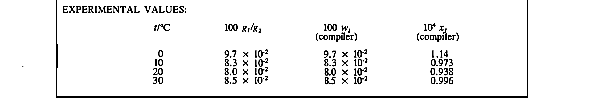

# Example: page 41 of volume 60, EXPERIMENTAL VALUES band

The crop `p041_0.png` (cut by `scripts/crop_tables.py` from the page image, located through
the text layer's word coordinates) and the table MinerU returned for it, verbatim from
`../crops/tables.jsonl`. The whole-page pass returned the same numbers as one string with the
rows run together (`0 9.7 × 10^{-2} 9.7 × 10^{-2} 1.1410 8.3 × ...`, see `../CHECKS.md`).



| t/°C | 100  $g_{1}/g_{2}$ | 100  $w_{1}$ (compiler) | $10^{4} x_{1}$ (compiler) |
|---|---|---|---|
| 0 | $9.7 \times 10^{-2}$ | $9.7 \times 10^{-2}$ | 1.14 |
| 10 | $8.3 \times 10^{-2}$ | $8.3 \times 10^{-2}$ | 0.973 |
| 20 | $8.0 \times 10^{-2}$ | $8.0 \times 10^{-2}$ | 0.938 |
| 30 | $8.5 \times 10^{-2}$ | $8.5 \times 10^{-2}$ | 0.996 |

Raw HTML:

```html
<table><tr><td colspan="4">EXPERIMENTAL VALUES:</td></tr><tr><td>t/°C</td><td>100  $g_{1}/g_{2}$ </td><td>100  $w_{1}$ (compiler)</td><td> $10^{4} x_{1}$ (compiler)</td></tr><tr><td>0</td><td> $9.7 \times 10^{-2}$ </td><td> $9.7 \times 10^{-2}$ </td><td>1.14</td></tr><tr><td>10</td><td> $8.3 \times 10^{-2}$ </td><td> $8.3 \times 10^{-2}$ </td><td>0.973</td></tr><tr><td>20</td><td> $8.0 \times 10^{-2}$ </td><td> $8.0 \times 10^{-2}$ </td><td>0.938</td></tr><tr><td>30</td><td> $8.5 \times 10^{-2}$ </td><td> $8.5 \times 10^{-2}$ </td><td>0.996</td></tr></table>
```
