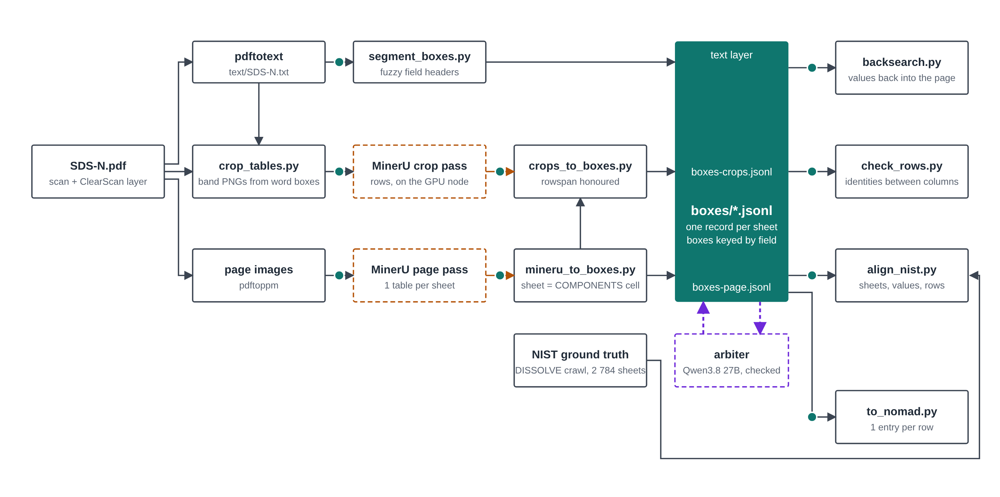
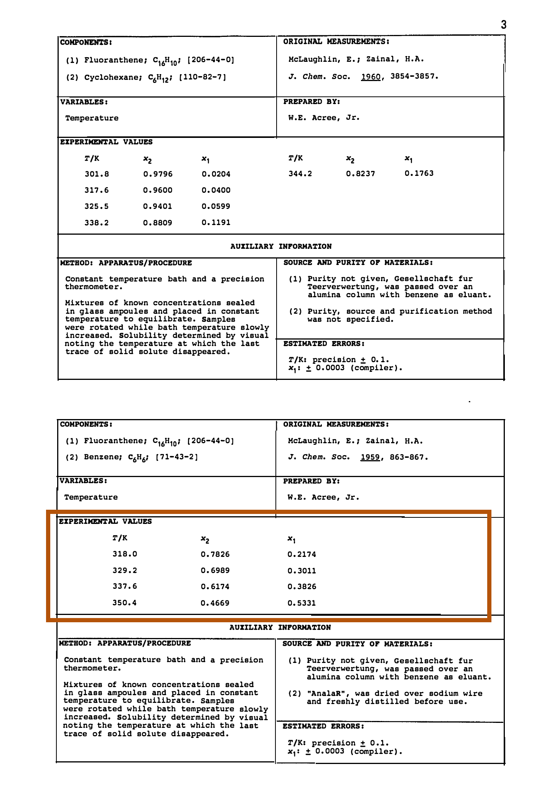
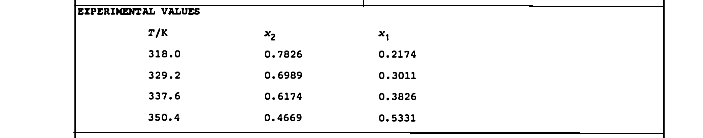
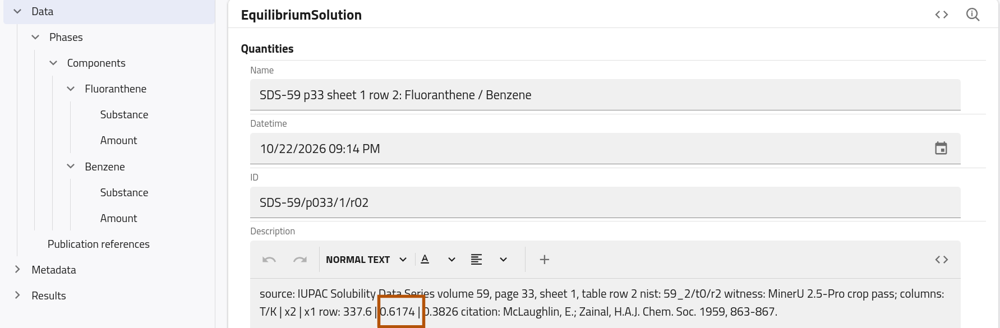
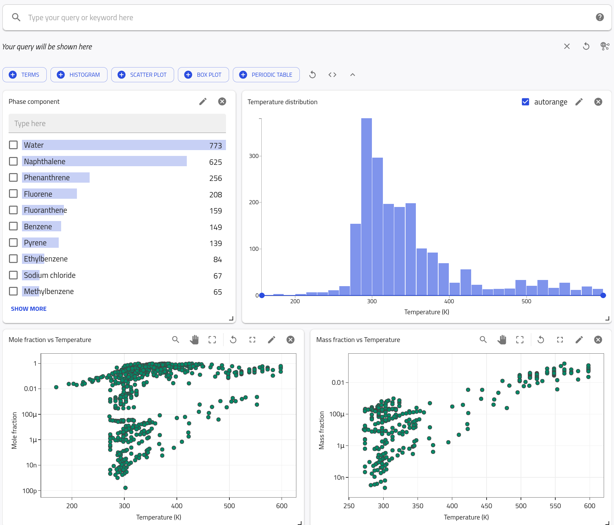
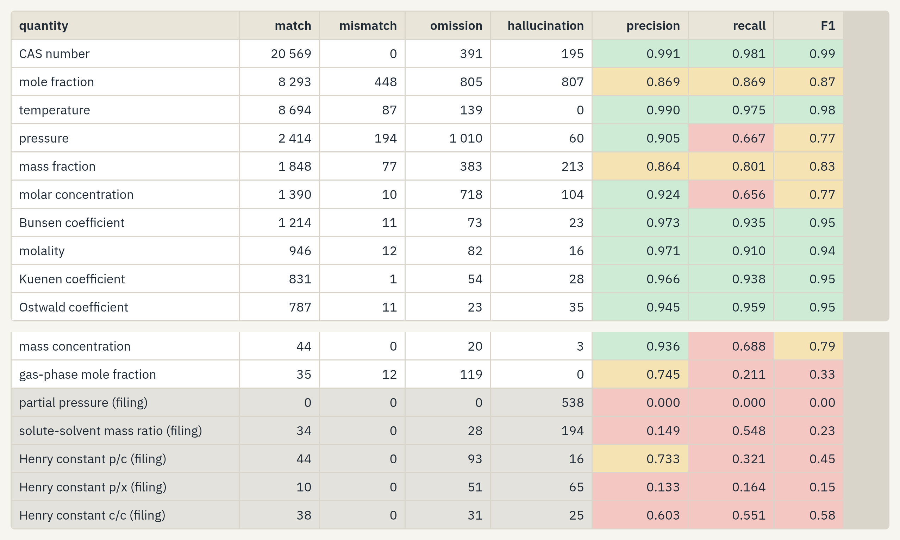
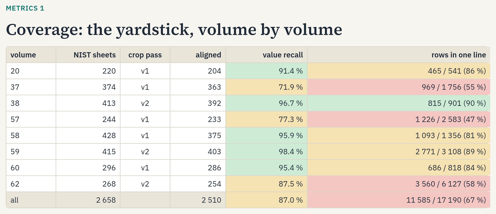
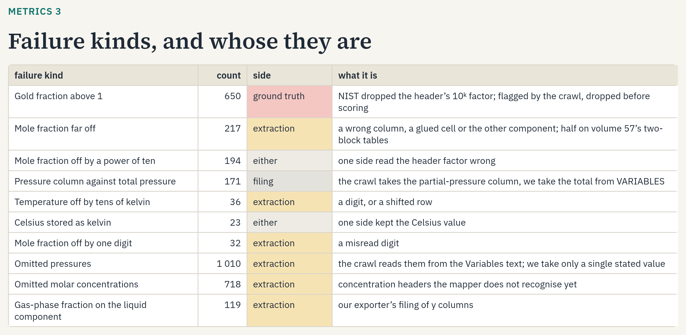

# Digitizing the IUPAC Solubility Data Series

SolTractor turns the IUPAC Solubility Data Series, the reference compilation of more than a century of critically evaluated solubility measurements, into machine-readable, searchable NOMAD entries, starting with the eight volumes that have a hand-keyed reference, and measures the extraction quality. It combines OCR with a vision model, run on whole pages and on cropped tables, and checks every value against the sheet's own chemistry and the hand-keyed IUPAC-NIST database. The result: 13,306 entries so far, at F1 0.92 against the reference.

## Approach

The [series](https://iupac.org/what-we-do/databases/solubility-data-series/) spans 1855 to 1990 in 56 scanned volumes, about 21,000 pages; only eight volumes were ever keyed by hand into the [IUPAC-NIST Solubility Database](https://srdata.nist.gov/solubility/). Chemists and process engineers still look up these values manually, and data-driven solubility models lack them. Rather than trusting one model, SolTractor reads every page several ways and checks every value:

- **Three readings.** The embedded OCR text layer keeps the row structure but breaks numbers (spaces inside numbers, commas for decimal points); the VLM [MinerU](https://github.com/opendatalab/MinerU) 2.5-Pro returns clean digits but runs table rows together. We therefore cut the experimental-values band out of every sheet, located by the table's title, and let the VLM read it alone (Figure 2a, 2b). The three readings are combined into one per-sheet record. We also tested a language model (Qwen 3.8, 27B) on the column headers our lookup does not recognise; filtered by the checks, it raised F1 only marginally, from 0.920 to 0.925.
- **Quality checks.** Where both raw data and derived values are tabulated, we use domain knowledge to compute one from the other, e.g. via $x_1 = \frac{w_1/M_1}{w_1/M_1 + w_2/M_2}$. The hand-keyed NIST volumes serve as ground truth, which we compare field by field with FAIRmat's [json-extract-eval](https://github.com/FAIRmat-NFDI/json-extract-eval).
- **FAIR export.** Every table row becomes one entry on [NOMAD](https://nomad-lab.eu), with provenance down to page and row (Figure 3a). A fixed lookup maps 84 % of the printed columns to their quantity and unit. A dashboard over the data set lets anyone search and plot the entries, and could serve for outlier detection (Figure 3b).

**Figure 1.** Data flow of SolTractor: all readings share one per-sheet record format, read by the checks, the alignment against IUPAC-NIST and the NOMAD exporter; the language model enters at the arbiter.

## Results

On the eight hand-keyed volumes, SolTractor finds 94 % of the 2,658 sheets, where the text layer alone loses up to two in three, and brings two thirds of the 17,190 rows back intact (Table S2). 98 % of 20,377 formula cross-checks agree within the last printed digit. Against the database, the extraction reaches F1 0.92 on 9,030 paired rows, with CAS numbers, temperatures, molalities and gas solubility coefficients at 0.94 to 0.99, and mole fractions at 0.87 (Table S1). The overall export holds 13,306 validated entries, 88 % with a typed solubility quantity; the first uploaded volumes are searchable on NOMAD, where a dashboard shows the measurements of many sheets side by side, to our knowledge the first time trends across this series can be explored at a glance. Code: [github.com/briling/SolTractor](https://github.com/briling/SolTractor).

**Figure 2a.** A scanned sheet from volume 59 with its table band outlined, located from the text layer.

**Figure 2b.** The cropped band alone, which the vision model reads back as rows.

**Figure 3a.** The 337.6 K row of that sheet as a NOMAD entry; the boxed mole fraction matches the print.

**Figure 3b.** The NOMAD dashboard over the uploaded entries (configuration in `nomad/dashboard.yaml`).

## Supporting tables

**Table S1.** Field-level scores against IUPAC-NIST on 9,030 paired rows, at 0.5 % relative tolerance; green from 0.90, amber from 0.70, grey rows are filing differences rather than reading errors.

**Table S2.** Coverage per volume: NIST sheets found, values found verbatim, and rows reproduced intact.

**Table S3.** Failure kinds by count and by side: ours, the ground truth's, or a filing difference.

## Next steps

Most of the rows that do not yet pair come from multi-block tables and from column headers our lookup does not recognise, while the errors that remain fall into a few named kinds, such as misread powers of ten (Table S3). Because these failures are named, they can be targeted directly. Since most of them arise where the text layer and the vision model disagree, we would like to bring the language model in at exactly that point, letting it arbitrate glued cells and shifted rows and keeping its answer only when the checks confirm it. The same checks could then grow beyond a single sheet: a knowledge graph linking compounds, systems and papers across volumes would let measurements of the same system, or the same paper compiled twice, verify each other as a third check from domain knowledge. With these checks in place, our goal is to run the crop pass on all 56 volumes and, eventually, to make the complete series available on NOMAD.
